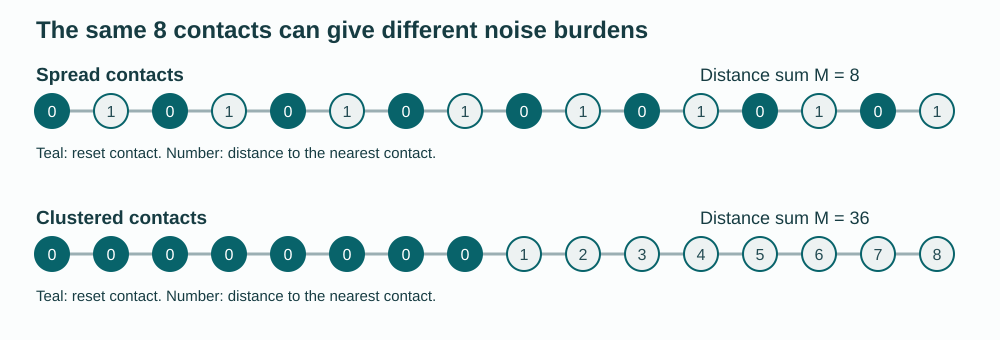

# Quantum Cooling Geometry

**How accurately can an entire noisy quantum register be initialized when entropy can leave only through selected reset contacts?** On a chain, the optimal error is determined, up to constant factors, by the sum of distances to the nearest contact. Spreading the same number of contacts across the register can change the error scaling.

For a path with reset set $`S`$, independent depolarization $`p`$ per round, and

```math
M=\sum_v\mathrm{dist}(v,S),
```

the optimal complete initialization error satisfies

```math
\boxed{\displaystyle
\frac{1-(1-p)^M}{2}
\le\epsilon_*\le\min\{1,pM\}.}
```

The lower bound permits arbitrary prescribed local entangling gates and contact CPTP maps. A periodic SWAP/reset conveyor attains the same order with no extra qubits. Error is half the diamond distance from pure-zero replacement, so the guarantee includes arbitrary reference-entangled inputs and every physical output qubit.



The figure uses 16 qubits and 8 contacts. The [general comparison](science/interpretation.md#the-same-contact-count-different-layouts) gives a linear distance sum for alternating contacts and a quadratic one for clustered contacts.

## Results

| Geometry | Distance sum or optimal error scale | Scientific account |
|---|---|---|
| Any finite connected graph with nonempty contacts | Exact lower bound $`[1-(1-p)^M]/2`$ | [Causal converse](science/converse.md) |
| Any fixed contact placement on a chain | $`\epsilon_*=\Theta(\min\{1,pM\})`$ when $`M>0`$ | [Matching path construction](science/geometry.md#every-fixed-contact-placement-on-a-path) |
| One endpoint contact on an $`n`$-qubit chain, $`n\ge2`$ | $`\Theta(\min\{1,pn^2\})`$ | [Exact conveyor channel](science/geometry.md#a-one-contact-path-conveyor) |
| Best placement of $`m\lt n`$ contacts on a chain | $`\Theta(\min\{1,pn(n-m)/m\})`$; exact minimum distance sum also given | [Contact placement](science/geometry.md#optimally-placed-contacts-on-a-path) |
| Slab of thickness $`L\ge2`$ and $`N`$ qubits, one full cold face | $`\Theta(\min\{1,pN(L-1)\})`$ | [Slab construction](science/geometry.md#rectangular-slabs-with-one-full-cold-face) |
| Every site is a contact | Exact zero error after a final parallel reset | [Output convention](science/model.md#register-contacts-and-round-convention) |

The constants in the order statements are absolute. For general graphs only the converse is asserted; a matching routing theorem is not supplied.

## Why longer cooling does not remove the floor

At the common output time, some recent noise events are too far from a contact for their entropy to reach it. A selected complete-depolarization event in this terminal region leaves a tracial qubit factor, even after arbitrary allowed coherent processing. Its output has largest eigenvalue at most one half. Counting such locations gives the finite-noise lower bound. The [full proof](science/converse.md) does not assume independent output errors or noiseless exact reset by the controller.

## Read and reproduce

Start with the [scientific overview](science/README.md) and [exact model](science/model.md), then read the [converse](science/converse.md), [constructions](science/geometry.md), and [physical consequences](science/interpretation.md). [Noise and scope](science/noise_and_scope.md) gives the mixed-unitary extension and target-preserving counterexamples. The [LLM reading guide](llms.txt) maps questions to authoritative files.

For a guided conceptual route, use the [Watrous 2018 source bridge and worked three-qubit example](learning/WATROUS_BRIDGE.md), then the [30-milestone map](learning/MILESTONES.md). The [learning entrypoint](learning/README.md) connects the prerequisites to the scientific proofs.

From the repository root:

```bash
python -m pip install -r verification/requirements.txt
python verification/verify.py
python verification/geometry_checks.py
python verification/make_figure.py
```

The [verification guide](verification/README.md) records numerical scopes, exact conventions and limits. Checks include arbitrary quantum controls and boundary channels, direct channel factorization, reference-sensitive replacement, interior-port trajectories and finite contact placements. Finite checks support the written analytical proofs.

## Scope and attribution

Each round applies disjoint nearest-neighbor unitary gates, independent depolarization on **all** sites including idle qubits, then CPTP operations at the contacts. The output follows the final contact operation. Contacts are ideal resources; bulk measurements, discarded workspace, protected side registers and observation-conditioned feedback are outside the model. All physical outputs must be pure together. Logical cooling, selected-subsystem polarization and thermodynamic heat or work costs are separate tasks.

One-port cooling and SWAP transport have prior precedents. The contribution here is the exact terminal-event factorization, the bound uniform over allowed coherent controls, and its matching physical-register accuracy law. [Related work](references/RELATED_WORK.md) identifies inherited constructions and distinguishes noisy algorithmic cooling, target-preserving dephasing and earlier reset models. The effect also occurs classically; no quantum-over-classical advantage is claimed.

## Purpose and contact

This repository serves as a record of the work and a guide for the author’s self-directed learning. For discussion or potential collaboration, please contact Ruge Lin at [gogoko699@gmail.com](mailto:gogoko699@gmail.com).
